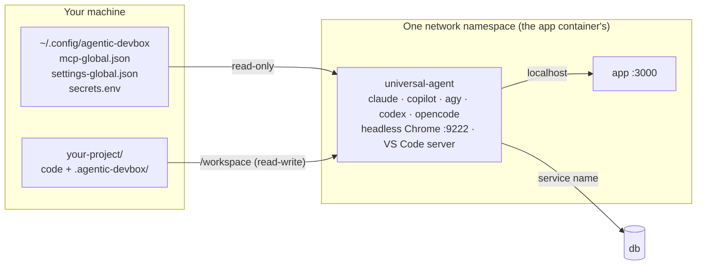

# agentic-devbox

Run Claude Code, GitHub Copilot CLI, Antigravity CLI, OpenAI Codex and OpenCode in an isolated Docker sidecar next to your app. The agents get their own headless Chrome and one shared MCP configuration, and each project's logins and history stay inside that project. You can work in VS Code inside the same sandbox.

[](https://github.com/aminkt/agentic-devbox/actions/workflows/ci.yml)
[](LICENSE)
[](https://docs.docker.com/compose/)

```bash
curl -fsSL https://raw.githubusercontent.com/aminkt/agentic-devbox/main/install.sh | bash
cd ~/.config/agentic-devbox/project-template
agentic-devbox up        # example app + Postgres + the agent sidecar
agentic-devbox claude    # or: copilot, agy, codex, opencode
```

What you get:

- **Five agent CLIs in one image**, each configured automatically when the container starts.
- **Your app on `localhost`.** The sidecar joins your app's network namespace, so `http://localhost:3000` inside the agent is your app.
- **A private browser.** Headless Google Chrome with DevTools on `localhost:9222`, the Chrome DevTools MCP server already connected, and a `/browser` skill in every agent.
- **One MCP and settings configuration in two layers**, global and per project, translated into each agent's native format.
- **VS Code in the sandbox**, either your desktop VS Code attached through Dev Containers or VS Code in the browser.
- **`docker exec` without the Docker socket.** An optional bridge lets agents run commands in your other containers, scoped to one Compose project.
- **Isolated state and locked-down defaults.** Logins live in `<project>/.agentic-devbox/home`; the agent runs non-root with no Linux capabilities.

## Documentation

| | |
| --- | --- |
| [Getting started](docs/getting-started.md) | Install, sign in, run the example, add the sidecar to your project |
| [Architecture](docs/architecture.md) | Parts, network model, mounts, startup, design decisions |
| [Configuration](docs/configuration.md) | MCP servers, agent settings, secrets, state, variables |
| [Browser testing](docs/browser-testing.md) | `/browser`, DevTools MCP tools, `devbox-browser`, Puppeteer and Playwright scripts |
| [VS Code](docs/vscode.md) | Desktop VS Code via Dev Containers, VS Code in the browser |
| [Exec bridge](docs/exec-bridge.md) | `docker exec` / `docker compose exec` from the sandbox |
| [Shared app environments](docs/shared-app-environments.md) | One sidecar for several projects served by one app container |
| [Multi-repo environments](docs/workplaces.md) | One sidecar for several repositories and services behind a reverse proxy |
| [Security](docs/security.md) | What is protected, credentials, egress, MCP servers, databases |
| [Commands](docs/cli.md) · [Troubleshooting](docs/troubleshooting.md) | Reference |

## How it works



- **Sidecar pattern.** Your project keeps its own compose file and adds an `include:` of the shared blueprint plus one line that attaches the agent to your app. The blueprint stays in one place, so `agentic-devbox update` reaches every project, and nothing is copied into your repository.
- **Shared network.** `network_mode: "service:app"` puts the agent inside the app's network namespace: same `localhost`, same service names, no port mapping. For environments with many services behind a proxy, the sidecar can instead join the project's networks as its own container and reach services by name and alias ([architecture](docs/architecture.md#the-network-model)).
- **Isolated testing browser.** Chrome runs headless inside the sidecar with a fresh in-memory profile at every start, reachable only from inside the namespace unless you forward it.
- **Dual-layer configuration.** Global and project files in the standard `mcpServers` format are merged and written into each agent's native file (`.claude.json`, `mcp-config.json`, `mcp_config.json`, `config.toml`, `opencode.json`) by a three-way merge that keeps what the agents write themselves.

Details: [docs/architecture.md](docs/architecture.md).

## Quick start

Requirements: Docker with the Compose plugin **v5.0 or newer**, on macOS or Linux (Windows through WSL 2), and about 5 GB of disk.

```bash
# 1. Install: clones to ~/.config/agentic-devbox, links the CLI, builds the image
curl -fsSL https://raw.githubusercontent.com/aminkt/agentic-devbox/main/install.sh | bash

# 2. Add the sidecar to your project ("web" is the service to attach to)
cd /path/to/your/project
agentic-devbox init --app web      # prints the compose lines to add

# 3. Start, sign in once, work
agentic-devbox up
agentic-devbox run claude auth login
agentic-devbox claude              # or open VS Code in the sidecar: agentic-devbox code
```

The lines `init` prints:

```yaml
include:
  - path: ${AGENTIC_DEVBOX_HOME:-${HOME}/.config/agentic-devbox}/base-compose.yml
    project_directory: .

services:
  universal-agent:
    network_mode: "service:web"
```

Sign-in options for every agent, API-key setup and the example project: [docs/getting-started.md](docs/getting-started.md).

## Browser testing

```text
/browser http://localhost:3000 add a note and confirm it appears without console errors
```

```bash
agentic-devbox browser screenshot http://localhost:3000 /tmp/home.png --full-page
agentic-devbox browser console http://localhost:3000     # exit 1 on console or network errors
agentic-devbox browser run tests/browser/add-note.mjs    # Puppeteer script against the sandbox Chrome
```

Agents also get the Chrome DevTools MCP tools (`navigate_page`, `take_snapshot`, `click`, `list_console_messages`, `take_screenshot`, `performance_start_trace` and more), already attached to the sandbox Chrome on `localhost:9222`. More, including Playwright: [docs/browser-testing.md](docs/browser-testing.md).

## MCP configuration

A server for every project goes in `~/.config/agentic-devbox/mcp-global.json`; a server for one project goes in `<project>/.agentic-devbox/mcp-project.json`. Both use the standard format, with `${VAR}` references for secrets:

```json
{
  "mcpServers": {
    "postgres": {
      "command": "npx",
      "args": ["-y", "@bytebase/dbhub@1.5.0", "--transport", "stdio", "--config", "/etc/agentic-devbox/project/dbhub.toml"],
      "env": { "PROJECT_DB_URL": "${PROJECT_DB_URL}" }
    }
  }
}
```

Put the value in `.agentic-devbox/secrets.env` (gitignored, mode 600) and restart the sidecar. `"disabled": true` removes a global server in one project, and `agentic-devbox run agentic-devbox-config mcp-check` starts every server and lists its tools. Full guide: [docs/configuration.md](docs/configuration.md).

## Security

> [!WARNING]
> An agent in this sandbox can read, change and delete everything in the project you mount, run any command inside the container, and reach the internet. The sandbox protects your machine and your other projects; the project you mount is fully in the agent's hands. Commit or back up before letting an agent run unattended.

- Keep credentials in the `secrets.env` files (mode 600, gitignored) and prefer scoped tokens.
- Never mount `/`, your home folder or `/var/run/docker.sock` into the sidecar. Use the exec bridge when agents need other containers.
- Restrict egress for sensitive projects: an `internal: true` network for offline work, or an allowlist proxy.
- Pin MCP server versions and give database servers a read-only role.

Full guidance: [docs/security.md](docs/security.md). To report a vulnerability: [SECURITY.md](SECURITY.md).

## Contributing

Bug reports, adapters for more AI coding tools, and documentation fixes are welcome. [CONTRIBUTING.md](CONTRIBUTING.md) covers the checks to run and the adapter contract.

## License

[MIT](LICENSE). If agentic-devbox saves you setup time, a star helps other developers find it.
