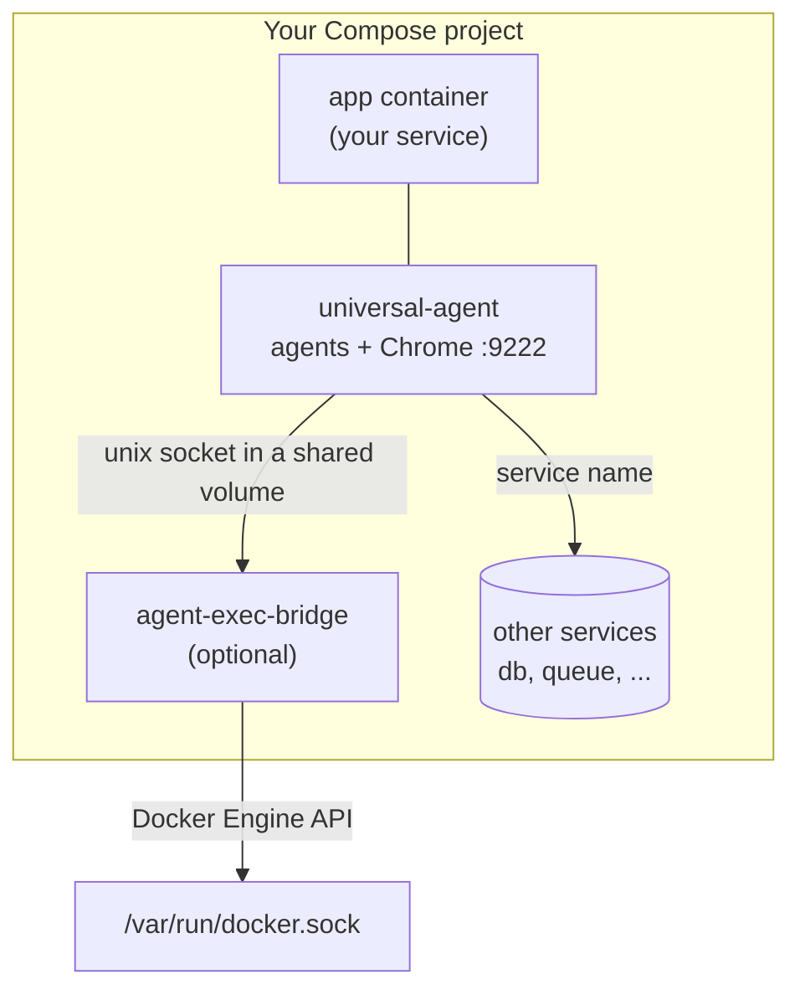
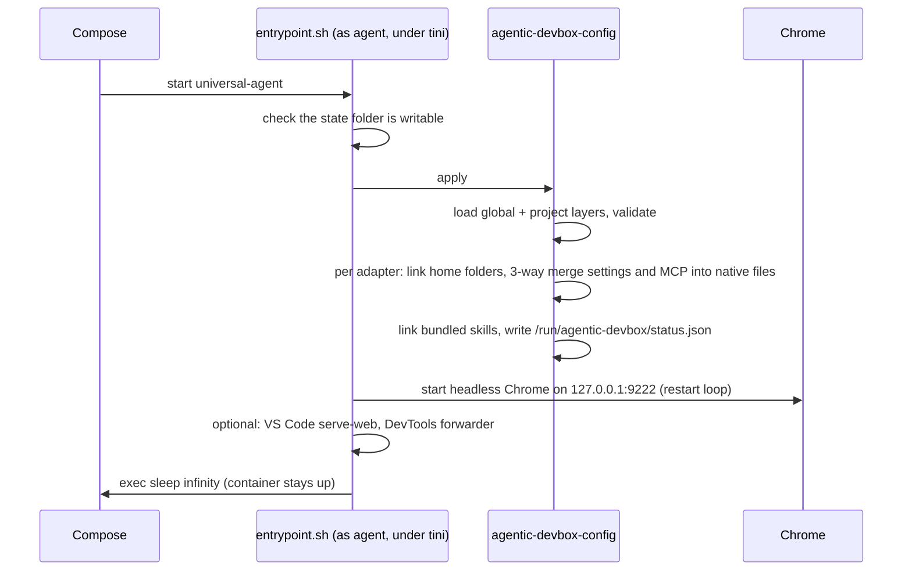
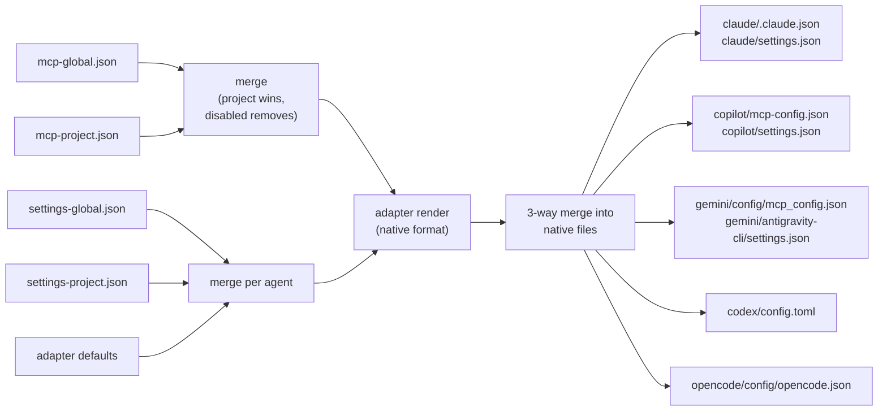

# Architecture

This page explains how agentic-devbox is put together: the parts, what happens when a sidecar starts, how configuration flows into each agent, and why the design looks the way it does. Read it when you want to change something, debug something, or judge whether the isolation fits your project.

## The parts

| Part | Where it lives | What it does |
| --- | --- | --- |
| Image `agentic-devbox:local` | Built from [`Dockerfile.agents`](../Dockerfile.agents), once per machine | Debian 13 with Node.js 24, Python 3, uv, git, gh, Google Chrome, the VS Code CLI and five agent CLIs |
| Blueprint | [`base-compose.yml`](../base-compose.yml) | Defines the `universal-agent` service: mounts, environment, limits, security options |
| Exec bridge (optional) | [`exec-bridge.yml`](../exec-bridge.yml) | A second service that runs `docker exec` on the sidecar's behalf, scoped to one Compose project |
| Runtime | [`runtime/`](../runtime/), baked into the image at `/opt/agentic-devbox` | Entrypoint, config engine, agent adapters, `devbox-browser`, the `docker` client, skills |
| Global layer | `~/.config/agentic-devbox/mcp-global.json`, `settings-global.json`, `secrets.env` | Defaults for every project on the machine |
| Project layer | `<project>/.agentic-devbox/` | Config for one project, plus its private state in `home/` |
| Host CLI | [`bin/agentic-devbox`](../bin/agentic-devbox), linked into `~/.local/bin` | Thin wrapper around `docker compose` |

`~/.config/agentic-devbox` is the repository itself: a git clone, or a symlink to your checkout. Nothing is copied out of it. Projects include the blueprint by path, the image bakes the runtime in at build time, and `agentic-devbox update` is a `git pull` followed by a rebuild.

## How a project uses it



Your compose file includes the blueprint:

```yaml
include:
  - path: ${AGENTIC_DEVBOX_HOME:-${HOME}/.config/agentic-devbox}/base-compose.yml
    project_directory: .

services:
  universal-agent:
    network_mode: "service:app"
```

Three Compose features make this work:

- **`include`** loads the blueprint as part of your project, so it gets your project's name, network and lifecycle.
- **`project_directory: .`** resolves the blueprint's relative paths (`./`, `./.agentic-devbox`) against your project instead of against `~/.config/agentic-devbox`. One blueprint serves every project.
- **Merging into an included service** (Compose v5 and newer) lets your file add `network_mode` and anything else to `universal-agent`. Maps and lists merge; scalar values replace.

## The network model

`network_mode: "service:app"` starts the sidecar inside the app container's network namespace. They share one loopback interface and one set of ports:

- `localhost:<port>` inside the sidecar is the app.
- Other services are reachable by name through the app's networks, exactly as the app reaches them.
- A port the app publishes on the host is the only way in from outside. The sidecar cannot publish ports of its own (Docker rejects `ports:` on a service with `network_mode: service:...`), so you publish extra ports, such as VS Code in the browser, on the app service.
- If the app container is recreated, Compose restarts the sidecar with it (`depends_on` with `restart: true` is added automatically).

Chrome binds `127.0.0.1:9222` inside this namespace. Nothing outside the namespace can reach it unless you forward it on purpose.

## Mounts

| Inside the sidecar | Comes from | Mode | Purpose |
| --- | --- | --- | --- |
| `/workspace` | the project folder (`./`) | read-write | The code the agents work on |
| `/workspace/.agentic-devbox` | an empty tmpfs | read-only | Hides credentials and config from the agents' view of the project |
| `/home/agent/.agentic-devbox` | `AGENTIC_DEVBOX_STATE_DIR` (default `./.agentic-devbox/home`) | read-write | Agent logins, sessions and native config files |
| `/etc/agentic-devbox/project` | `./.agentic-devbox` | read-only | Project layer: `mcp-project.json`, `settings-project.json`, extra config files |
| `/etc/agentic-devbox/global/*.json` | `~/.config/agentic-devbox/*.json` | read-only | Global layer |
| `/home/agent/.cache` | named volume `agent-cache` | read-write | npm and uv downloads, seeded from the image |
| `/home/agent/.vscode-server` | named volume `vscode-server` | read-write | VS Code server and extensions |
| `/run/agentic-devbox` | tmpfs | read-write | Browser profile, logs, status; gone when the container stops |
| `/run/agent-exec-bridge` | named volume (bridge only) | read-only | The bridge's unix socket |

Named volumes get the project's name as a prefix (`myapp_agent-cache`), so two projects never share them.

## What happens at start



`tini -g` is PID 1. It reaps zombies and forwards `docker stop` to the whole process group, so Chrome and VS Code shut down cleanly. The healthcheck (`agentic-devbox-config healthcheck`) reports healthy once the configuration is applied and Chrome answers on its DevTools port.

You attach agents with `docker compose exec universal-agent <agent>` (the `agentic-devbox` CLI does this for you), or through VS Code ([vscode.md](vscode.md)).

## How configuration reaches each agent



Every agent has an **adapter**, a small module in [`runtime/adapters/`](../runtime/adapters/). It declares where the agent keeps its state, which links to create (for example `~/.codex` → `~/.agentic-devbox/codex`), its settings file and format, where MCP servers go in which file, and how one server definition translates into the agent's dialect. The engine discovers every adapter file, so supporting another tool means adding one file ([CONTRIBUTING.md](../CONTRIBUTING.md#add-support-for-another-ai-coding-tool)).

The engine never overwrites a native file wholesale. It runs a **three-way merge** with three inputs: what the layers declare now, what the file holds, and what it declared last time (stored as `.agentic-devbox.applied.json` next to the agent's state). Declared keys win, keys the agent wrote for itself stay, and keys you removed from a layer are removed, unless the agent changed them since.

`${VAR}` references are handled per agent. Claude Code and OpenCode resolve them at launch, so their files keep the reference. Codex receives env var names where its format allows. Copilot CLI and Antigravity CLI get resolved values, written to the private state folder.

## The exec bridge

Agents often need to run commands in another container of the project (`docker exec app php artisan ...`). Giving the sidecar the Docker socket would give every agent root on the host. The bridge keeps the socket in a separate container instead:

1. `agent-exec-bridge` runs from the same image, as root inside its own container, with no network, no capabilities and a read-only filesystem. It mounts the Docker socket and listens on a unix socket in a volume that only the sidecar also mounts.
2. Inside the sidecar, `docker` and `docker-compose` are small clients ([`runtime/bin/docker`](../runtime/bin/docker)). They understand `exec`, `compose exec` and `ps`, and send each request to the bridge.
3. The bridge looks up its own Compose project from its container labels, resolves the target by container or service name *within that project*, applies the user policy, creates the exec through the Docker Engine API and streams stdin, stdout, stderr, TTY resizes and the exit code both ways.

Details and policies: [exec-bridge.md](exec-bridge.md).

## Design decisions

| Decision | Why |
| --- | --- |
| A sidecar next to the app, not a devcontainer replacing it | Your app keeps its own image and Compose setup; the sandbox adds one service and changes nothing else |
| Shared network namespace | The agent tests the app at `localhost` exactly as you would, with no port plumbing |
| One image per machine, state per project | Builds once, then every project starts fast while logins and history stay separate |
| Layers mounted read-only | An agent cannot add MCP servers to itself or relax its own permissions |
| Native files written by a 3-way merge | Each agent keeps working with its own UI and commands (`claude mcp list`, `/config`), and your layers still win |
| No Docker socket in the sidecar | Root on the host is the one thing an agent must never get; the optional bridge exposes `exec` only, for one project |
| Agent CLIs update with the image | A rebuild is reproducible and reaches every project; in-place updates would differ per container |
